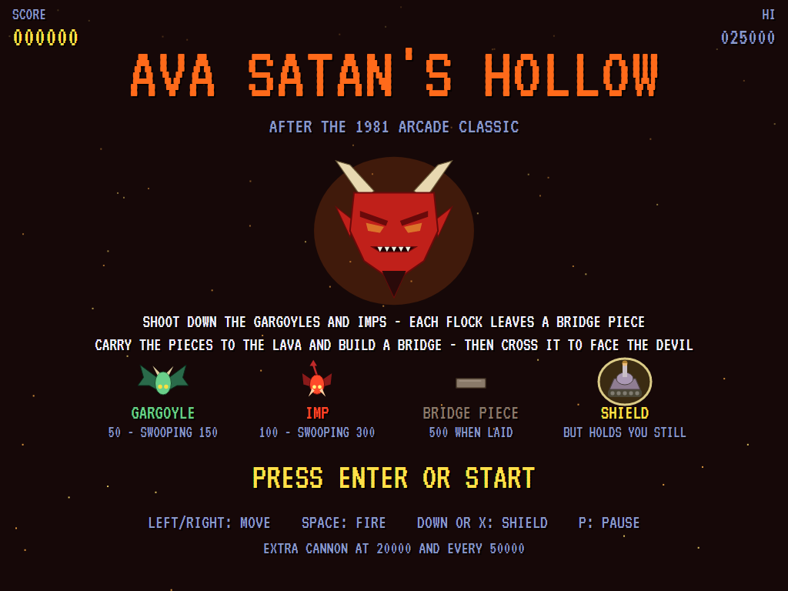
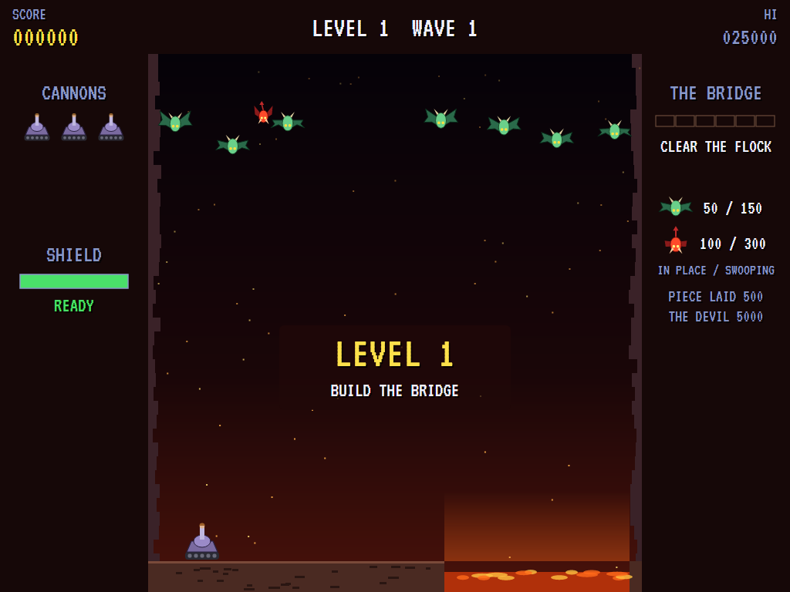
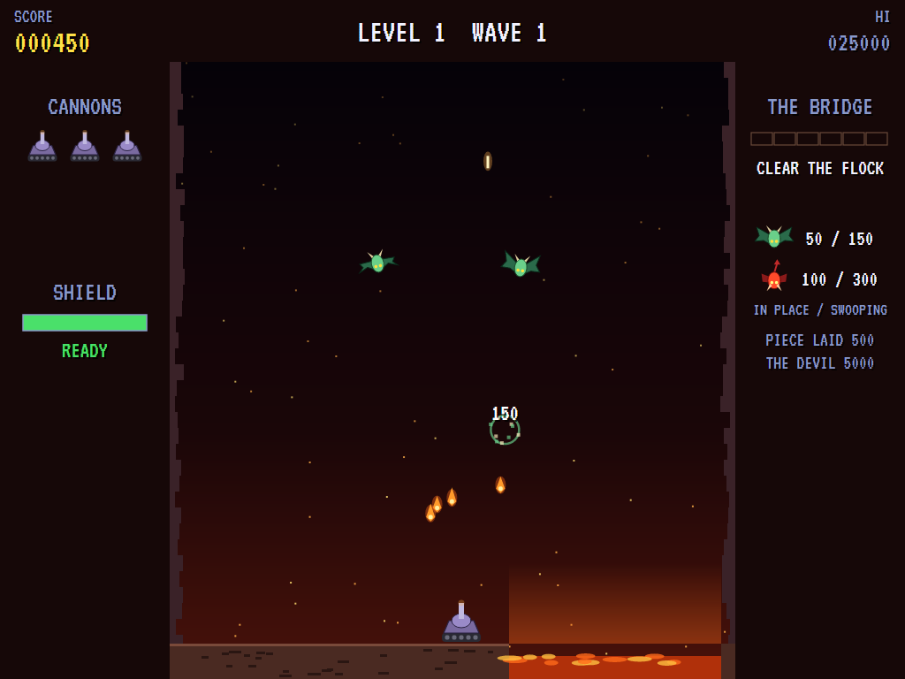
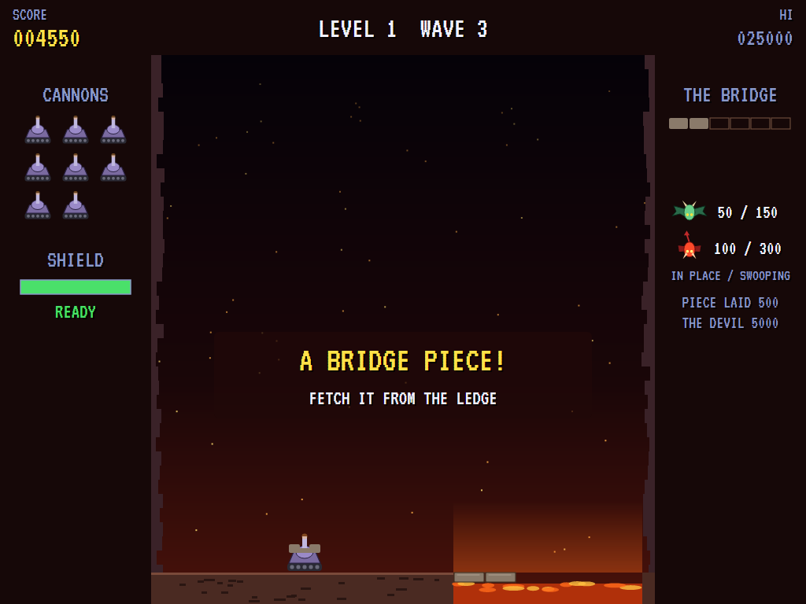
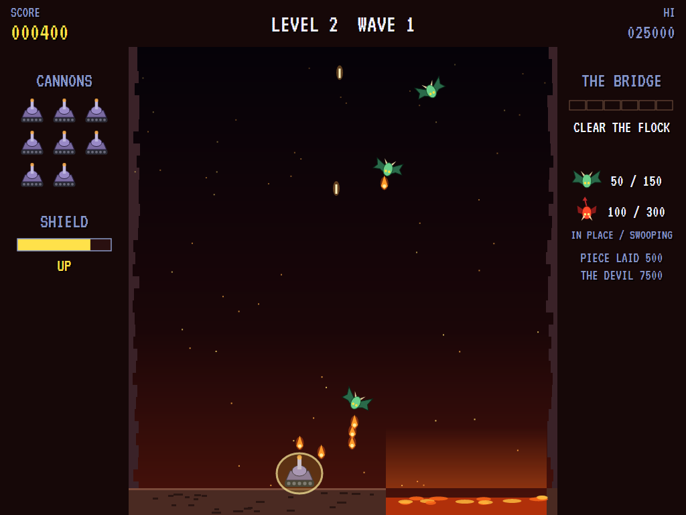
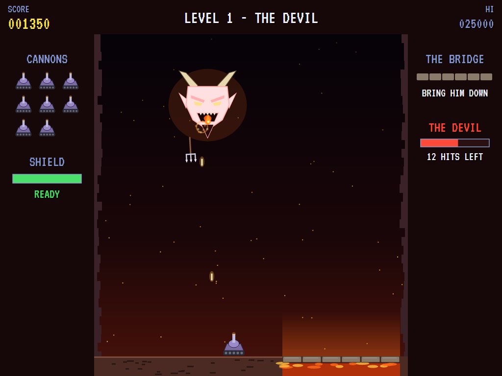
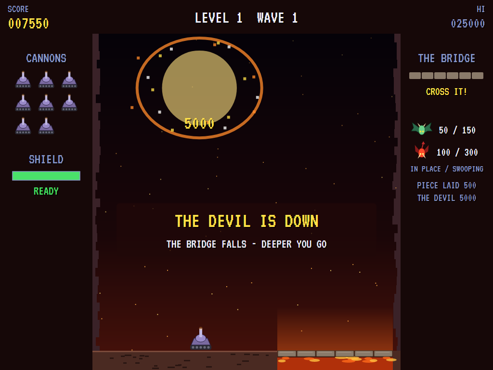
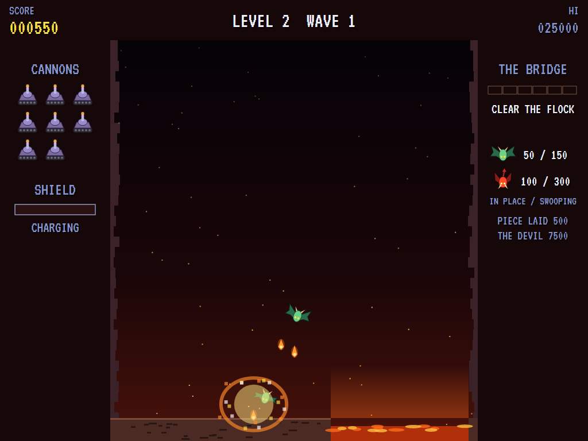
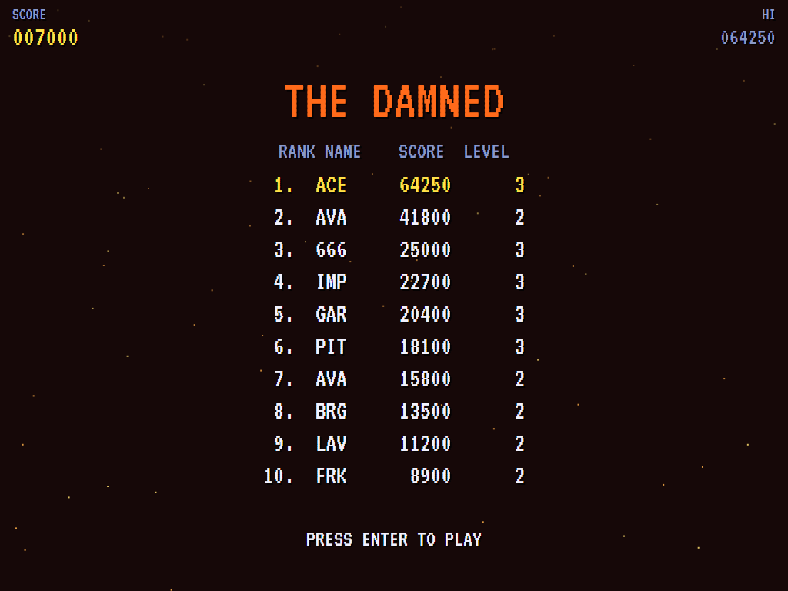

# AVA Satan's Hollow

[](https://github.com/Harlock123/AVASatansHollow/actions/workflows/build.yml)

A demon-blasting shooter in the style of the 1981 arcade game **Satan's Hollow**, built with .NET 10 and
Avalonia UI. Flocks of gargoyles and imps swoop down on your cannon, dropping fire. Each flock you shoot
down leaves a piece of a bridge on the ledge. Carry the pieces to the lava chasm and build the bridge, then
cross it to face the Devil himself.

## Features

- **Your cannon**:
  - **Moving and firing:** it runs along the floor of the Hollow and fires flaming bolts upward, up to two at once. Hold the button to keep firing.
  - **The shield:** a golden dome that stops fireballs and pitchforks and destroys any demon that flies into it. It holds the cannon still while it's up, and the panel on the left shows it recharging afterwards.
- **The flock**:
  - **Arriving:** each flock flies in from both sides on curving paths, settles into a flapping formation over the floor of the Hollow, and sways from side to side.
  - **Swooping:** demons peel off, loop out and swoop down. Any that miss come round from the top back to their places, and the last three of a flock attack without a break.
  - **Gargoyles** (green, bat-winged) drop fireballs as they swoop and from the formation when you pass beneath.
  - **Imps** (small and red) don't fire, but they're quicker and turn hard after the cannon to ram it.
  - **Later waves and levels** bring more imps, more swoopers at once, and a quicker pace.
- **The bridge**:
  - **Pieces:** every flock you clear leaves a bridge piece glowing on the ledge at the far left.
  - **Laying them:** drive over to pick a piece up, carry it to the chasm, and lay it at the end of the bridge for 500 points, all while the next flock attacks.
  - **Losing one:** if you're shot while carrying a piece, it turns up back on the ledge.
  - **Crossing:** six pieces span the lava. Once the bridge is built, drive across it.
- **The Devil**:
  - **His attack:** his great horned head rises over the Hollow, sways from side to side, spits fans of fire and hurls pitchforks. A pitchfork can't be shot down; dodge it or shield yourself.
  - **Bringing him down:** it takes 22 hits, more on each level. He shrugs off shots while he's rising and for a moment after each hit.
  - **The next level:** when he falls, the bridge falls with him and you go deeper into the next level, faster.
- **Scoring**:

  | | Points |
  |---|---|
  | Gargoyle | 50 in the flock, 150 swooping |
  | Imp | 100 in the flock, 300 swooping |
  | Bridge piece laid | 500 |
  | Each hit on the Devil | 100 |
  | The Devil brought down | 5,000, plus 2,500 a level |

  - **Extra cannons** come at 20,000 and every 50,000 after that.
- **Sound**:
  - **The title tune:** an original whirling tarantella in D minor.
  - **The effects:** the bolts, the whoosh of fireballs, the swoops' leathery whistle, the bridge's chimes and thuds, the Devil's rumbling rise, his grunts, his laugh and his whirling pitchfork, and the lava's rumble, plus jingles.
  - All of it is synthesised and mixed by OpenAL.
- **Attract mode**: leave the title alone for 15 seconds and a computer pilot plays, from a random point in the building of the bridge.
  - It dodges fireballs, pitchforks and swoopers, raising the shield when there's nowhere to go.
  - When it's safe enough, it fetches and lays the bridge pieces and crosses to fight the Devil.
- **A top-ten high-score table** with arcade-style initials entry. It records the level reached.
- **Gamepads** through SDL2, as well as the keyboard.
- **Any window size**: the screen scales to fit, letterboxed. **Ctrl+S** saves a screenshot.
- **One self-contained executable** per platform: Windows, macOS and Linux on Intel/AMD and ARM.

## Screenshots

| The title | The flock flies in | Swooping |
|:---------:|:------------------:|:--------:|
|  |  |  |
| What everything is worth. | From both sides. | Fire coming down. |

| Carrying a piece | The shield | The Devil |
|:----------------:|:----------:|:---------:|
|  |  |  |
| To the end of the bridge. | Nothing gets through. | Fire and pitchforks. |

| The Devil falls | Burnt | The damned |
|:---------------:|:-----:|:----------:|
|  |  |  |
| And the bridge with him. | One fireball too many. | The high-score table. |

The screenshots are made by the tests, which play the game in a real (headless) window; see
[Tests](#tests).

## Download and run

Ready-to-run builds for Windows, macOS and Linux, on both Intel/AMD and ARM, are on the
[Releases page](https://github.com/Harlock123/AVASatansHollow/releases/tag/latest). **Latest build** is
rebuilt on every push to `main`. Each download is one self-contained executable: no .NET install is
needed.

| Platform | Archive |
|---|---|
| Windows | `AVASatansHollow-win-x64.zip`, `AVASatansHollow-win-x86.zip`, `AVASatansHollow-win-arm64.zip` |
| macOS | `AVASatansHollow-osx-arm64.tar.gz` (Apple silicon), `AVASatansHollow-osx-x64.tar.gz` (Intel) |
| Linux | `AVASatansHollow-linux-x64.tar.gz`, `AVASatansHollow-linux-arm64.tar.gz`, `AVASatansHollow-linux-arm.tar.gz` |

```bash
tar -xzf AVASatansHollow-linux-x64.tar.gz     # or linux-arm64, linux-arm, osx-arm64, osx-x64
./AVASatansHollow
```

On Windows, unzip and run `AVASatansHollow.exe`. On macOS, if Gatekeeper refuses to open it, run
`xattr -d com.apple.quarantine AVASatansHollow` once. Run with `--no-audio` for silence.

**Sound** comes through OpenAL Soft, built in for every platform. In a virtual machine the game
detects it and uses a larger audio buffer, so the sound doesn't break up.

**Gamepads** use SDL2, which is bundled for Windows, macOS and Intel/AMD Linux. ARM Linux builds need it
installed; without it the keyboard still works:

```bash
sudo apt install libsdl2-dev            # Debian / Ubuntu / Raspberry Pi OS
sudo pacman -S --needed sdl2-compat     # Arch / Omarchy
```

## Controls

| Input | Action |
|-------|--------|
| **Enter** | Start |
| **Left** / **Right** (or **A** / **D**, or the numeric keypad) | Move |
| **Space** / **Z** / **Up** / **W** / **Ctrl** | Fire (hold to keep firing) |
| **Down** / **X** / **S** / **Shift** | Raise the shield |
| **P** / **Esc** | Pause (Esc again to quit) |
| **M** | Mute |
| **Ctrl+S** / **Cmd+S** | Save a screenshot to the Pictures folder |

Pieces are picked up, laid and the bridge crossed just by driving there.

**Gamepad**: left stick or D-pad to move, **A** or **X** to fire, **B** or **Y** (or down) for the
shield, **Start** to start and pause, **Back** (while paused) to quit.

**Entering initials**: type letters, or dial with **Up**/**Down** and accept with **Space**; **Left** /
**Backspace** go back; **Enter** finishes.

## Tests

```bash
dotnet test AVASatansHollow.slnx
```

The engine has no UI and runs in fixed 60 Hz steps, so it plays the same at any frame rate, and a seed
always plays the same game. The tests check:

- **The flock:**
  - flying in to its places
  - more imps later
  - points in place and swooping
  - swoops coming round home
  - fire dropped on the way down
- **The cannon:**
  - running from the ledge to the end of the bridge and no further
  - two shots at a time, and holding the button to keep firing
  - the shield holding it still, stopping fire, destroying rammers and needing to recharge
- **The bridge:**
  - a piece left by each cleared flock
  - picked up, carried and laid for 500
  - dropped back on the ledge when you're shot
  - never more pieces than the bridge needs
- **The Devil:**
  - crossing the finished bridge to raise him
  - his fans of fire and his pitchforks
  - 22 hits to bring him down, and the bridge falling for the next level
- **Losing cannons:** to fire, to rammers and to pitchforks (which only the shield stops), and the last ending the game
- **The machine:** extra cannons, the attract cycle, the computer pilot building the bridge and beating the Devil, the same game from the same seed, and pausing

The screenshot tests draw the real screen in a headless window. To refresh the README's pictures:

```bash
HOLLOW_SHOTS=$PWD/Images dotnet test tests/AVASatansHollow.Tests --filter ScreenshotTests
```

To see how the computer pilot gets on, level by level (for tuning), or how a player who just sits and
fires does (`HOLLOW_PROBE=lazy`):

```bash
HOLLOW_PROBE=1 dotnet test tests/AVASatansHollow.Tests --filter PilotProbe --logger "console;verbosity=detailed"
```

## Building

```bash
dotnet build AVASatansHollow.slnx
dotnet run --project src/AVASatansHollow
```

Needs the .NET 10 SDK. The sounds are made by `tools/make_sounds.py` (standard-library Python):
`python3 tools/make_sounds.py` rewrites `src/AVASatansHollow/Sounds`.

## Project structure

```
AVASatansHollow/
├── AVASatansHollow.slnx
├── src/AVASatansHollow/
│   ├── Engine/
│   │   ├── GameEngine.cs        # States, the title and demo cycle, and the Hollow's rumble
│   │   ├── GameEngine.Play.cs   # The cannon and its shield, the flocks and their swoops, the bridge,
│   │   │                        # the Devil, and scoring
│   │   ├── ShipPilot.cs         # The computer pilot, for the demonstration (and the tests)
│   │   ├── Entities.cs          # The field, the cannon, shots, fireballs, demons and the Devil
│   │   ├── HighScoreTable.cs, InitialsEntry.cs
│   │   ├── InputHandler.cs, ControllerManager.cs  # Keys and an SDL2 gamepad
│   │   └── SoundManager.cs      # Effects and the tunes through OpenAL
│   ├── Audio/                   # The OpenAL engine (from the author's AVABand)
│   ├── Views/                   # The cavern, the lava and the bridge, the cannon, the demons, the
│   │                            # Devil, the panels, the screens
│   └── Sounds/                  # The synthesised effects, the Devil's laugh and the tunes
├── tests/AVASatansHollow.Tests/ # Gameplay, screenshot and probe tests
├── tools/make_sounds.py
└── Images/                      # Screenshots
```

## About and licence

AVA Satan's Hollow © 2026 Lonnie Watson, under the [MIT License](LICENSE).

*Satan's Hollow* © 1981 Bally Midway; the name belongs to its current owner. AVA Satan's Hollow is an
independent, unofficial game in its style. Its cannon, its gargoyles and imps, its bridge, its Devil, its
graphics, sounds, tunes and code are its own; nothing is taken from the arcade machine's program,
graphics, sound or music. It is not affiliated with or endorsed by any rights holder.
